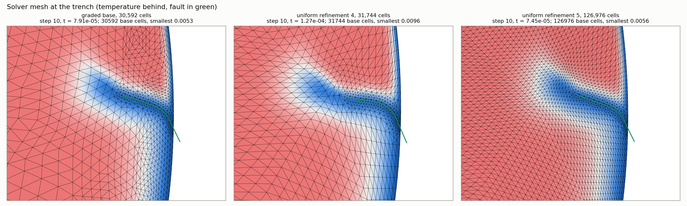

# Trial: a radially graded annulus base under the moving mesh and the fault

Interim, 2026-11-14 00:10 UTC. The graded run is still going (step 10 of 60). Same model, driver and code as `mmpde_fault_sample_runs.md`, plus one new driver option, `uw_cell_inner`.

## 1. Does a graded base survive the refinement hierarchy?

Yes, if the grading is a smooth radial ramp and the refinement count is low. `Annulus(cellSizeOuter, cellSizeInner, refinement)` sets the coarse sizes at the two boundaries, and uniform refinement halves them everywhere. A thin band (200 km of 40 km cells) cannot be drawn on the coarse level, but a ramp can.

Median cell edge (km) of the finest level by depth:

| Coarse size outer / inner, refinement | Cells | 0–200 km | 200–660 km | 660–1500 km | 1500–2900 km |
|---|---|---|---|---|---|
| 0.5 / 0.5, 5 (uniform) | 126,976 | 40 | 38–40 | 37–38 | 42 |
| 0.5 / 0.5, 4 (uniform) | 31,744 | 80–86 | 77–80 | 73–76 | 85 |
| 0.0625 / 0.3125, 2 | 29,952 | 45 | 51–67 | 89–108 | 134–189 |
| 0.125 / 0.625, 3 | 37,504 | 45 | 46–55 | 72–94 | 111–158 |
| 0.25 / 1.25, 4 | 52,224 | 48 | 48 | 57–61 | 78–97 |
| 0.03125 / 0.3125, 2 | 64,704 | 23–26 | 37–52 | 72–84 | 113–175 |

A 1:5 ramp is kept in full at refinement 1 or 2, mostly at 3, and is largely lost at 4, where the coarse level has too few cells to carry it.

## 2. The moving mesh and the fault on that base

Run: coarse size 0.0625 (outer) to 0.3125 (inner), refinement 2, 30,592 base cells, 4 ranks, production fault lengths, mesh moved every 5 steps (three moves before the first fault). Multigrid levels of 1,912, 7,648 and 30,592 cells.

- **It runs.** The fault is placed in parallel at every step so far; all steps converged in 3 to 6 Newton iterations.
- **The lower mantle stays coarse.** The mover works relative to the base, so the grading is kept: 130 to 230 km below 2000 km depth.
- **The top is as fine as on the uniform refinement-5 base, on a quarter of the cells.**

Cell edge (km) at step 10, 10th percentile / median, in cold material (T < 0.5):

| Where | Graded base, 30,592 cells | Uniform ref 4, 31,744 cells | Uniform ref 5, 126,976 cells |
|---|---|---|---|
| Lid, top 100 km, all round | 20 / 26 | 36 / 43 | 21 / 24 |
| Lid, top 100 km, within 750 km of the trench | 22 / 35 | 43 / 58 | 25 / 32 |
| Slab, 100–200 km | 31 / 36 | 55 / 63 | 30 / 34 |
| Slab, 200–400 km | 41 / 44 | 47 / 67 | 26 / 34 |
| Slab, 400–660 km | 65 / 75 | 54 / 63 | 24 / 30 |
| Smallest cell anywhere | 16.5 | 29.9 | 17.4 |

- **It does not reach 10 km.** From a 45 km base the lid goes to 26 km (median) and 20 km (10th percentile): a factor of 1.7 to 2.3, not 4. The slab below the lid tightens by only 1.3.
- **The limit is the node count, not the mover's ratio.** The mover has a fixed number of nodes and its cells are close to equilateral. It already puts 37% of all cells in the top 100 km (11,300 of 30,592), up from 15% on the unmoved base. Covering the top 100 km all round with 10 km equilateral cells needs about 93,000 cells; with 20 km cells, about 23,000. So 10 km in the boundary layer is affordable only near the trench, which means the metric has to be told to prefer the trench region. That is the next trial.

## 3. Cost

First steps only (0 to 10 for the graded run, 0 to 20 for the others), on a shared 96-thread Linux workstation, so indicative.

| Run | Ranks | Median s/step | Core-seconds per step | Median dt | Core-seconds per unit model time |
|---|---|---|---|---|---|
| Graded base + moving mesh | 4 | 88 | 420 | 8.0e-6 | 5.7e7 |
| Uniform ref 4 + moving mesh | 4 | 151 | 680 | 1.0e-5 | 6.8e7 |
| Uniform ref 5 + moving mesh | 10 | 315 | 3,230 | 6.3e-6 | 4.8e8 |

The uniform refinement-5 production run on a Linux cluster took a median 100 s/step on 26 ranks (2,600 core-seconds per step).

The graded run costs about an eighth of the refinement-5 moving-mesh run per unit of model time, for the same resolution in the lid and the slab's top 200 km. Whether it gives the same slip and trench history is not known until the run has gone further.
