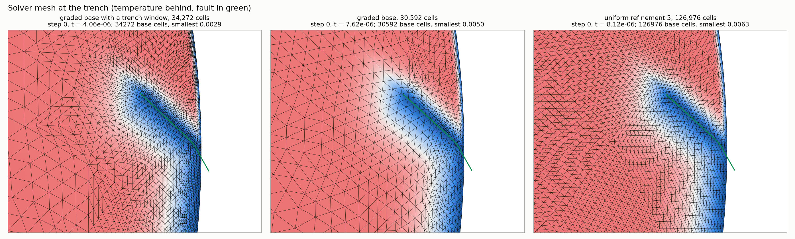
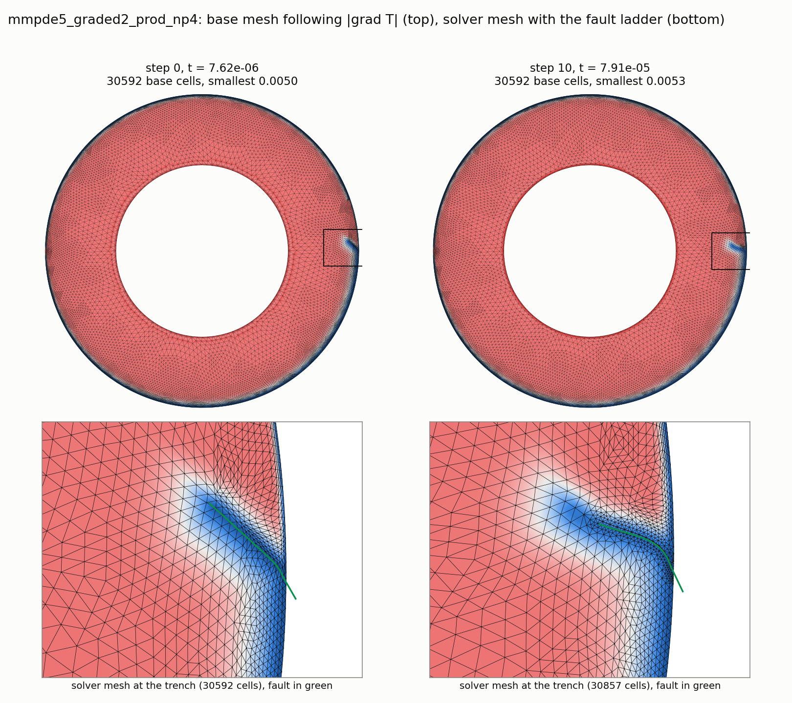
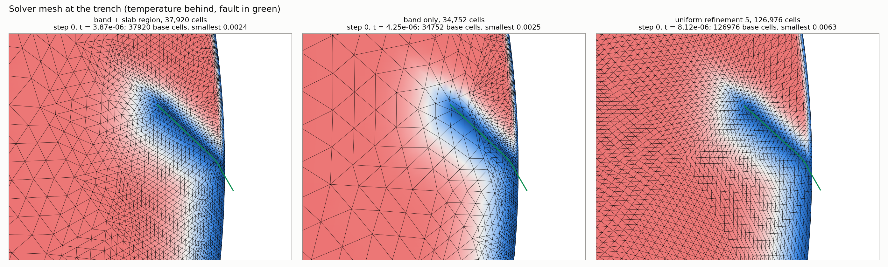

# Trial: a radially graded annulus base under the moving mesh and the fault

Interim, 2026-11-14 01:25 UTC. The radially graded run is still going (step 46 of 60); a production-length run on the banded base with a slab region (section 4) is queued behind it. **Section 4 is the current design**; sections 2 and 3 are the steps that led to it. Same model, driver and code as `mmpde_fault_sample_runs.md`, plus new driver options for the base: `uw_cell_inner`, `uw_cell_window`, `uw_cell_band`, `uw_cell_grow`.

## 1. Does a graded base survive the refinement hierarchy?

Yes, if the grading is a smooth radial ramp and the refinement count is low. `Annulus(cellSizeOuter, cellSizeInner, refinement)` sets the coarse sizes at the two boundaries, and uniform refinement halves them everywhere. A thin band (200 km of 40 km cells) cannot be drawn on the coarse level, but a ramp can.

Median cell edge (km) of the finest level by depth:

| Coarse size outer / inner, refinement | Cells | 0–200 km | 200–660 km | 660–1500 km | 1500–2900 km |
|---|---|---|---|---|---|
| 0.5 / 0.5, 5 (uniform) | 126,976 | 40 | 38–40 | 37–38 | 42 |
| 0.5 / 0.5, 4 (uniform) | 31,744 | 80–86 | 77–80 | 73–76 | 85 |
| 0.0625 / 0.3125, 2 | 29,952 | 45 | 51–67 | 89–108 | 134–189 |
| 0.125 / 0.625, 3 | 37,504 | 45 | 46–55 | 72–94 | 111–158 |
| 0.25 / 1.25, 4 | 52,224 | 48 | 48 | 57–61 | 78–97 |
| 0.03125 / 0.3125, 2 | 64,704 | 23–26 | 37–52 | 72–84 | 113–175 |

A 1:5 ramp is kept in full at refinement 1 or 2, mostly at 3, and is largely lost at 4, where the coarse level has too few cells to carry it.

## 2. The moving mesh and the fault on the radially graded base

Run: coarse size 0.0625 (outer) to 0.3125 (inner), refinement 2, 30,592 base cells, 4 ranks, production fault lengths, mesh moved every 5 steps (three moves before the first fault). Multigrid levels of 1,912, 7,648 and 30,592 cells.

- **It runs.** The fault is placed in parallel at every step so far; all steps converged.
- **The lower mantle stays coarse.** The mover works relative to the base, so the grading is kept: 130 to 230 km below 2000 km depth.
- **The top is as fine as on the uniform refinement-5 base, on a quarter of the cells** (table in section 3).
- **It does not reach 10 km.** From a 45 km base the lid goes to 26 km (median) and 20 km (10th percentile): a factor of 1.7 to 2.3, not 4. The slab below the lid tightens by only 1.3.
- **The history tracks the other runs so far.** Slip / trench / vrms at t = 1.0e-4, 1.5e-4, 2.0e-4: 773 / −1.45° / 240, 1068 / −2.10° / 292, 2044 / −3.04° / 481. The uniform refinement-5 production run has 767 / −1.25° / 230, 1079 / −1.90° / 284, 1904 / −2.76° / 445.

Why not a factor of 4:

- **The mover is short of nodes in the lid, not of ratio.** It already puts 37% of all cells in the top 100 km, up from about 15% on the unmoved base. Doubling the metric's ratio to 16 changes little (lid 24 km median, 17 km 10th percentile).
- **The mover redistributes nodes along the radius, not round the annulus.** A metric tapered to favour the trench region made the lid elsewhere coarser and left the trench region unchanged (34 km): the nodes it freed went down, not along. So extra nodes for the trench region must already be in the base, in the columns under it.

## 3. A trench window in the base

The base cell size is multiplied by a factor within 1000 km (arc length) of the trench and above 700 km depth, with smooth tapers beyond. This goes in on the coarse level and survives refinement 2. Two variants, each run for the three initial moves and one step on 2 ranks:

- **A**: coarse size 0.0625 to 0.3125, window factor 1/2. 34,272 cells.
- **B**: coarse size 0.09375 to 0.3125, window factor 1/3. 24,864 cells. Coarser round the annulus, the same 22 km base in the window.

Cell edge (km), 10th percentile / median, in cold material (T < 0.5), after the initial moves:

| Where | Window A, 34,272 | Window B, 24,864 | Radial grading only, 30,592 | Uniform ref 4, 31,744 | Uniform ref 5, 126,976 |
|---|---|---|---|---|---|
| Lid, top 100 km, all round | 18 / 25 | 17 / 32 | 20 / 26 | 39 / 45 | 23 / 26 |
| Lid, within 1000 km of the trench | 13 / 17 | 14 / 17 | 23 / 32 | 49 / 59 | 30 / 35 |
| Slab, 100–200 km | 18 / 24 | 16 / 23 | 25 / 35 | 49 / 62 | 30 / 36 |
| Slab, 200–400 km | 17 / 27 | 15 / 23 | 28 / 41 | 41 / 56 | 27 / 34 |
| Slab, 400–660 km | 20 / 29 | 15 / 22 | 55 / 72 | 46 / 56 | 26 / 30 |
| Smallest cell anywhere | 8.9 | 9.3 | 15.5 | 33.0 | 19.8 |
| Below 2000 km depth (median) | 202 | 212 | 212 | 96 | 43 |

- With the window the smallest cells are 9 km, the lid at the trench is 13 to 17 km and the slab is 15 to 23 km down to 660 km, on a fifth of the cells of the uniform refinement-5 base (variant B).
- The mover's gain over the base is still about 1.3 to 2.3, so the base has to be within a factor of 2 of the target, not 4.
- The price is the time step: 3.3e-6 (B) and 4.1e-6 (A) at step 0, against 7.6e-6 on the radially graded base.

The radially graded run, steps 0 and 10:

## 4. A band of typical boundary-layer thickness, plus a slab region

A fixed base cannot follow the boundary layer; it can only be fine over a typical boundary-layer thickness. So: 22 km cells in the top 100 km all round, growing quickly below (to about 220 km in the lower mantle), with no linear ramp. Three variants, each run for the three initial moves and one step on 2 ranks:

- **Band only**: 34,752 cells.
- **Band, gentler growth below**: 43,072 cells.
- **Band plus a slab region**: the base is also held at 34 km (1.5 × the band) down to 700 km within 1000 km of the trench. 37,920 cells; the slab region costs about 3,200 of them.

Cell edge (km), 10th percentile / median, in cold material (T < 0.5), after the initial moves:

| Where | Band + slab region, 37,920 | Band only, 34,752 | Band, gentler growth, 43,072 | Uniform ref 5, 126,976 |
|---|---|---|---|---|
| Lid, top 100 km, all round | 12 / 16 | 12 / 17 | 11 / 16 | 23 / 26 |
| Lid, within 1000 km of the trench | 14 / 20 | 14 / 19 | 13 / 18 | 30 / 35 |
| Slab, 100–200 km | 20 / 24 | 19 / 34 | 20 / 28 | 30 / 36 |
| Slab, 200–400 km | 18 / 29 | 30 / 45 | 25 / 41 | 27 / 34 |
| Slab, 400–660 km | 22 / 29 | 93 / 113 | 59 / 69 | 26 / 30 |
| Smallest cell anywhere | 7.5 | 7.9 | 7.4 | 19.8 |
| Below 2000 km depth (median) | 237 | 231 | 231 | 43 |
| Time step at step 0 | 3.9e-6 | 4.3e-6 | 3.1e-6 | 8.1e-6 |

- **The band does the lid.** From 22 km the mover reaches 12 to 17 km everywhere, without tying the base to where the trench starts.
- **The band alone leaves the slab unresolved.** Two thirds of all cells end up in the lid and the slab below 400 km stays at the base's size: the mover does not pull nodes down the slab.
- **A coarse slab region fixes that cheaply.** With the base at 34 km there, the slab is at 24 to 29 km down to 660 km. This variant is finer than the uniform refinement-5 base with the moving mesh everywhere in cold material, on 30% of the cells.
- The fault was placed and step 0 converged in all three.

## 5. Cost

First steps only (0 to 10 for the graded run, 0 to 20 for the others), on a shared 96-thread Linux workstation, so indicative.

| Run | Ranks | Median s/step | Core-seconds per step | Median dt | Core-seconds per unit model time |
|---|---|---|---|---|---|
| Radially graded base + moving mesh | 4 | 88 | 420 | 8.0e-6 | 5.7e7 |
| Uniform ref 4 + moving mesh | 4 | 151 | 680 | 1.0e-5 | 6.8e7 |
| Uniform ref 5 + moving mesh | 10 | 315 | 3,230 | 6.3e-6 | 4.8e8 |

- The uniform refinement-5 production run on a Linux cluster took a median 100 s/step on 26 ranks (2,600 core-seconds per step).
- The radially graded run costs about an eighth of the refinement-5 moving-mesh run per unit of model time, for the same resolution in the lid and the slab's top 200 km. Its step time rises as the slab speeds up (140 to 170 s near t = 2e-4).
- Windowed bases, one step on 2 ranks: 194 s (A) and 126 s (B). With the smaller time step, B should cost roughly the same per unit of model time as the radially graded base. The 4-rank run of B will measure it.

## Limits of this trial

- The window (section 3) and the slab region (section 4) are fixed in the base. The trench moves about 14° (870 km) by t = 8e-4 in the production run, so a long run needs a wider or offset window.
- The banded base has only been run for one step; its history and cost per step await the queued run.
- The band and the window are put in through a size callback wrapped round the library's annulus mesher from the driver. A proper option on the mesher is library work, not done here.
