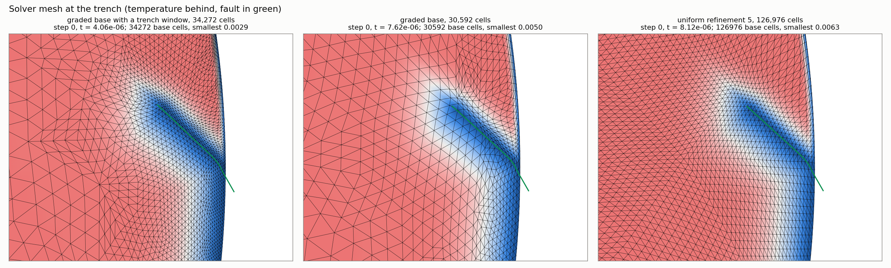
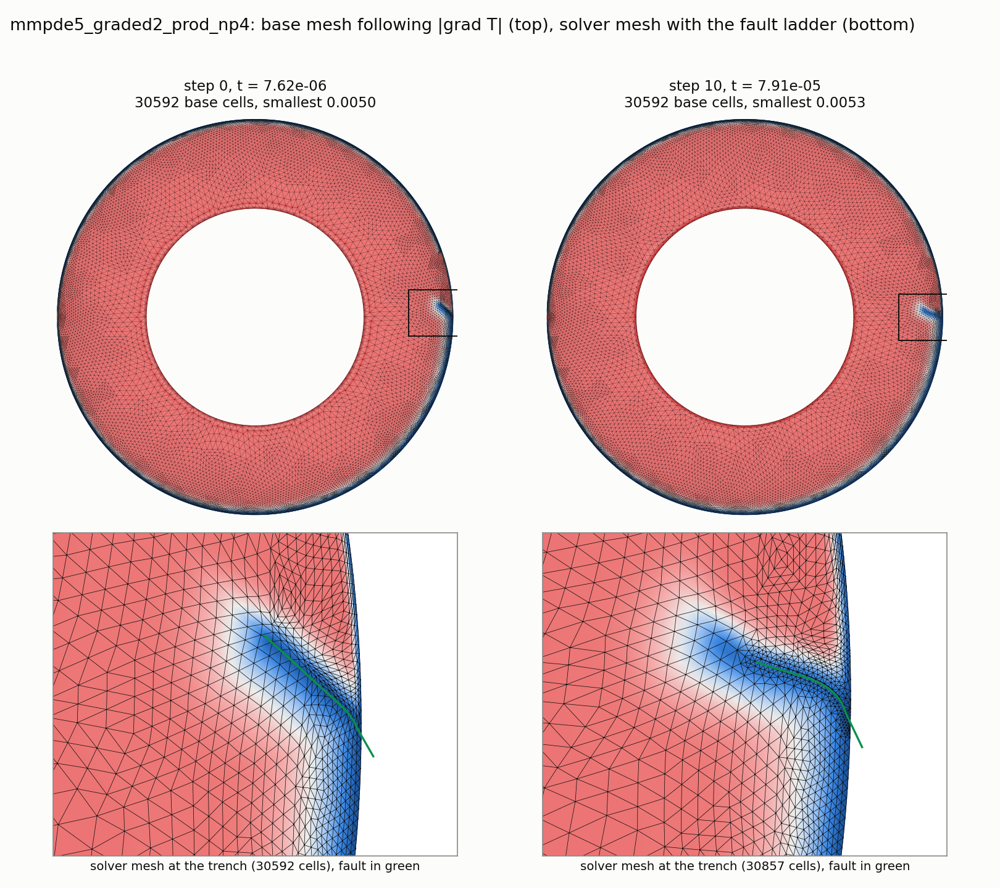
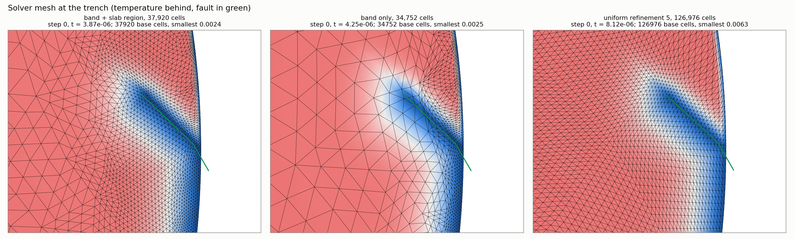
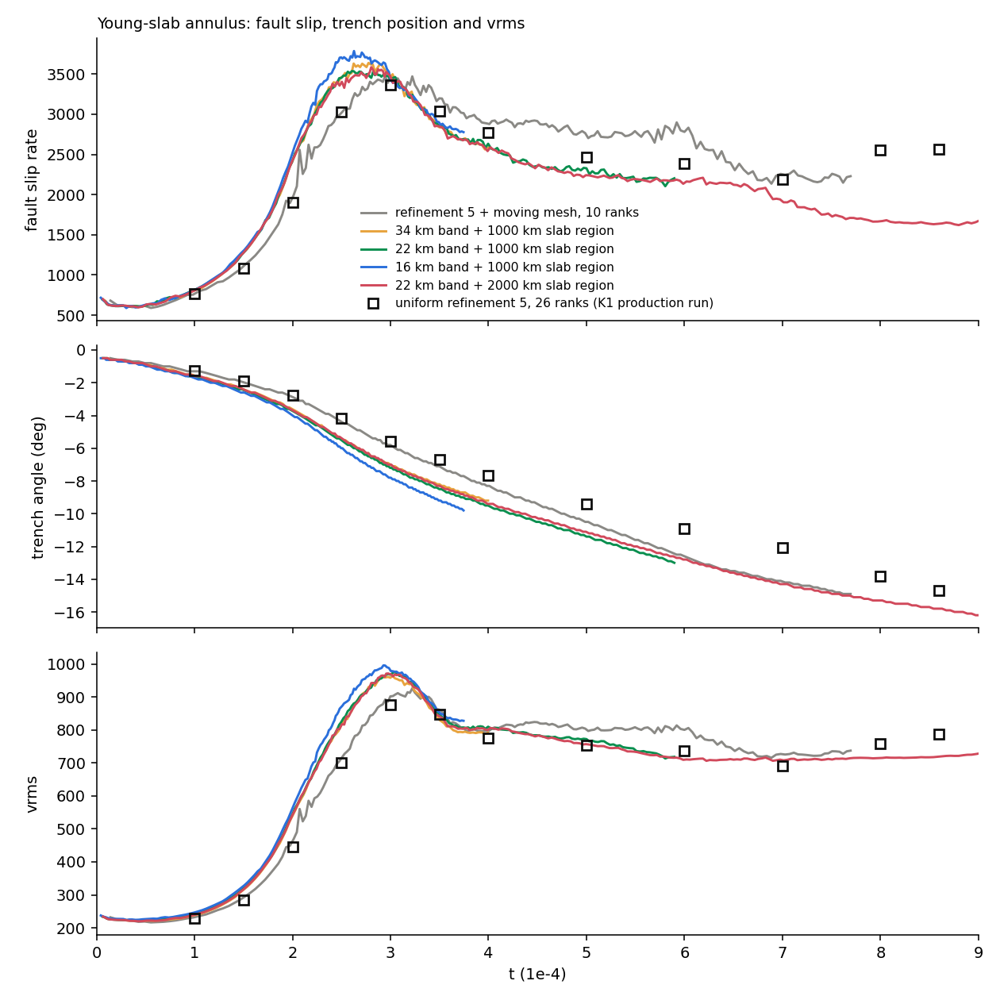

# Trial: a radially graded annulus base under the moving mesh and the fault

Status at 2026-11-15 00:30 UTC. All runs have finished: the radially graded base (60 steps, to t = 3.44e-4), the banded base with a slab region (200 steps, to t = 5.90e-4), and three overnight runs (section 7): the same base with a coarser and a finer lid band, and with a slab region twice as wide (280 steps, to t = 9.06e-4). **Section 4 is the current design, with the wider slab region of section 7**; sections 2 and 3 are the steps that led to it. Same model, driver and code as `mmpde_fault_sample_runs.md`, plus new driver options for the base: `uw_cell_inner`, `uw_cell_window`, `uw_cell_band`, `uw_cell_grow`.

## 1. Does a graded base survive the refinement hierarchy?

Yes, if the grading is a smooth radial ramp and the refinement count is low. `Annulus(cellSizeOuter, cellSizeInner, refinement)` sets the coarse sizes at the two boundaries, and uniform refinement halves them everywhere. A thin band (200 km of 40 km cells) cannot be drawn on the coarse level, but a ramp can.

Median cell edge (km) of the finest level by depth:

| Coarse size outer / inner, refinement | Cells | 0–200 km | 200–660 km | 660–1500 km | 1500–2900 km |
|---|---|---|---|---|---|
| 0.5 / 0.5, 5 (uniform) | 126,976 | 40 | 38–40 | 37–38 | 42 |
| 0.5 / 0.5, 4 (uniform) | 31,744 | 80–86 | 77–80 | 73–76 | 85 |
| 0.0625 / 0.3125, 2 | 29,952 | 45 | 51–67 | 89–108 | 134–189 |
| 0.125 / 0.625, 3 | 37,504 | 45 | 46–55 | 72–94 | 111–158 |
| 0.25 / 1.25, 4 | 52,224 | 48 | 48 | 57–61 | 78–97 |
| 0.03125 / 0.3125, 2 | 64,704 | 23–26 | 37–52 | 72–84 | 113–175 |

A 1:5 ramp is kept in full at refinement 1 or 2, mostly at 3, and is largely lost at 4, where the coarse level has too few cells to carry it.

## 2. The moving mesh and the fault on the radially graded base

Run: coarse size 0.0625 (outer) to 0.3125 (inner), refinement 2, 30,592 base cells, 4 ranks, production fault lengths, mesh moved every 5 steps (three moves before the first fault). Multigrid levels of 1,912, 7,648 and 30,592 cells.

- **It runs.** The fault is placed in parallel at every step so far; all steps converged.
- **The lower mantle stays coarse.** The mover works relative to the base, so the grading is kept: 130 to 230 km below 2000 km depth.
- **The top is as fine as on the uniform refinement-5 base, on a quarter of the cells** (table in section 3).
- **It does not reach 10 km.** From a 45 km base the lid goes to 26 km (median) and 20 km (10th percentile): a factor of 1.7 to 2.3, not 4. The slab below the lid tightens by only 1.3.
- **The history tracks the other runs so far.** Slip / trench / vrms at t = 1.0e-4, 1.5e-4, 2.0e-4: 773 / −1.45° / 240, 1068 / −2.10° / 292, 2044 / −3.04° / 481. The uniform refinement-5 production run has 767 / −1.25° / 230, 1079 / −1.90° / 284, 1904 / −2.76° / 445.

Why not a factor of 4:

- **The mover is short of nodes in the lid, not of ratio.** It already puts 37% of all cells in the top 100 km, up from about 15% on the unmoved base. Doubling the metric's ratio to 16 changes little (lid 24 km median, 17 km 10th percentile).
- **The mover redistributes nodes along the radius, not round the annulus.** A metric tapered to favour the trench region made the lid elsewhere coarser and left the trench region unchanged (34 km): the nodes it freed went down, not along. So extra nodes for the trench region must already be in the base, in the columns under it.

## 3. A trench window in the base

The base cell size is multiplied by a factor within 1000 km (arc length) of the trench and above 700 km depth, with smooth tapers beyond. This goes in on the coarse level and survives refinement 2. Two variants, each run for the three initial moves and one step on 2 ranks:

- **A**: coarse size 0.0625 to 0.3125, window factor 1/2. 34,272 cells.
- **B**: coarse size 0.09375 to 0.3125, window factor 1/3. 24,864 cells. Coarser round the annulus, the same 22 km base in the window.

Cell edge (km), 10th percentile / median, in cold material (T < 0.5), after the initial moves:

| Where | Window A, 34,272 | Window B, 24,864 | Radial grading only, 30,592 | Uniform ref 4, 31,744 | Uniform ref 5, 126,976 |
|---|---|---|---|---|---|
| Lid, top 100 km, all round | 18 / 25 | 17 / 32 | 20 / 26 | 39 / 45 | 23 / 26 |
| Lid, within 1000 km of the trench | 13 / 17 | 14 / 17 | 23 / 32 | 49 / 59 | 30 / 35 |
| Slab, 100–200 km | 18 / 24 | 16 / 23 | 25 / 35 | 49 / 62 | 30 / 36 |
| Slab, 200–400 km | 17 / 27 | 15 / 23 | 28 / 41 | 41 / 56 | 27 / 34 |
| Slab, 400–660 km | 20 / 29 | 15 / 22 | 55 / 72 | 46 / 56 | 26 / 30 |
| Smallest cell anywhere | 8.9 | 9.3 | 15.5 | 33.0 | 19.8 |
| Below 2000 km depth (median) | 202 | 212 | 212 | 96 | 43 |

- With the window the smallest cells are 9 km, the lid at the trench is 13 to 17 km and the slab is 15 to 23 km down to 660 km, on a fifth of the cells of the uniform refinement-5 base (variant B).
- The mover's gain over the base is still about 1.3 to 2.3, so the base has to be within a factor of 2 of the target, not 4.
- The price is the time step: 3.3e-6 (B) and 4.1e-6 (A) at step 0, against 7.6e-6 on the radially graded base.

The radially graded run, steps 0 and 10:

## 4. A band of typical boundary-layer thickness, plus a slab region

A fixed base cannot follow the boundary layer; it can only be fine over a typical boundary-layer thickness. So: 22 km cells in the top 100 km all round, growing quickly below (to about 220 km in the lower mantle), with no linear ramp. Three variants, each run for the three initial moves and one step on 2 ranks:

- **Band only**: 34,752 cells.
- **Band, gentler growth below**: 43,072 cells.
- **Band plus a slab region**: the base is also held at 34 km (1.5 × the band) down to 700 km within 1000 km of the trench. 37,920 cells; the slab region costs about 3,200 of them.

Cell edge (km), 10th percentile / median, in cold material (T < 0.5), after the initial moves:

| Where | Band + slab region, 37,920 | Band only, 34,752 | Band, gentler growth, 43,072 | Uniform ref 5, 126,976 |
|---|---|---|---|---|
| Lid, top 100 km, all round | 12 / 16 | 12 / 17 | 11 / 16 | 23 / 26 |
| Lid, within 1000 km of the trench | 14 / 20 | 14 / 19 | 13 / 18 | 30 / 35 |
| Slab, 100–200 km | 20 / 24 | 19 / 34 | 20 / 28 | 30 / 36 |
| Slab, 200–400 km | 18 / 29 | 30 / 45 | 25 / 41 | 27 / 34 |
| Slab, 400–660 km | 22 / 29 | 93 / 113 | 59 / 69 | 26 / 30 |
| Smallest cell anywhere | 7.5 | 7.9 | 7.4 | 19.8 |
| Below 2000 km depth (median) | 237 | 231 | 231 | 43 |
| Time step at step 0 | 3.9e-6 | 4.3e-6 | 3.1e-6 | 8.1e-6 |

- **The band does the lid.** From 22 km the mover reaches 12 to 17 km everywhere, without tying the base to where the trench starts.
- **The band alone leaves the slab unresolved.** Two thirds of all cells end up in the lid and the slab below 400 km stays at the base's size: the mover does not pull nodes down the slab.
- **A coarse slab region fixes that cheaply.** With the base at 34 km there, the slab is at 24 to 29 km down to 660 km. This variant is finer than the uniform refinement-5 base with the moving mesh everywhere in cold material, on 30% of the cells.
- The fault was placed and step 0 converged in all three.

## 5. Histories on the graded bases

Entries are fault slip rate / trench angle / vrms. All three left-hand columns use the moving mesh.

| t | Band + slab region, 37,920 | Radial ramp, 30,592 | Uniform ref 5, 126,976 | Uniform ref 5 production run (fixed mesh) |
|---|---|---|---|---|
| 1.0e-4 | 816 / −1.64° / 243 | 773 / −1.45° / 240 | 766 / −1.30° / 232 | 767 / −1.25° / 230 |
| 1.5e-4 | 1278 / −2.44° / 320 | 1068 / −2.10° / 292 | 1110 / −1.97° / 292 | 1079 / −1.90° / 284 |
| 2.0e-4 | 2423 / −3.72° / 546 | 2044 / −3.04° / 481 | 1964 / −2.87° / 463 | 1904 / −2.76° / 445 |
| 2.5e-4 | 3454 / −5.51° / 826 | 2708 / −4.42° / 666 | 3018 / −4.39° / 715 | 3024 / −4.15° / 701 |
| 3.0e-4 | 3432 / −7.20° / 969 | 3559 / −6.20° / 897 | 3477 / −5.80° / 902 | 3361 / −5.57° / 877 |
| 3.4e-4 | 2980 / −8.23° / 884 | 3247 / −7.62° / 884 | 3349 / −6.90° / 898 | not sampled |
| 3.5e-4 | 2852 / −8.50° / 847 | ended at 3.44e-4 | 3197 / −7.11° / 861 | 3037 / −6.70° / 847 |
| 4.0e-4 | 2626 / −9.51° / 810 | | 2880 / −8.30° / 798 | 2777 / −7.68° / 775 |
| 5.0e-4 | 2327 / −11.40° / 773 | | 2739 / −10.50° / 801 | 2470 / −9.42° / 755 |
| 5.5e-4 | 2180 / −12.27° / 739 | | 2784 / −11.60° / 808 | not sampled (6.0e-4: 2390 / −10.90° / 737) |

- **Radial ramp.** In family with the other moving-mesh runs: slip 10% low at 2.5e-4 and 6% high at 3.0e-4, trench about 1° ahead of the production run at the end. No failed steps, no placement refusals in 60 steps.
- **Band plus slab region, to the slip peak.** It runs ahead of every other run on the rise, by roughly 0.4e-4 in time: its slip peaks near t = 2.6e-4 to 2.9e-4 (3,450 to 3,540) where the others peak near 3.0e-4 to 3.2e-4. The peak level is the same. Cause not identified. This base has 12 to 16 km cells in the lid where the others have 24 to 40 km, and the weak crust is 11 km thick, so the lid may not be converged in the refinement-5 runs; that is a guess. Section 7 rules this out: the rise does not move when the lid band is coarsened to 34 km or refined to 16 km.
- **Band plus slab region, after the peak.** It settles close to the production run: slip 5% to 6% lower at 4.0e-4 and 5.0e-4, vrms 2% to 5% higher. The refinement-5 moving-mesh run sits 4% to 11% higher in slip over the same interval. No slip spikes.
- **Its trench lead stops growing.** The trench is 1.6° ahead of the production run at 3.0e-4 and 1.8° to 2.0° ahead from 3.5e-4 to 5.0e-4: the lead is built on the rise, and after the peak the trench retreats at the production run's rate (1.9° per 1e-4 against 1.7°). The refinement-5 moving-mesh run's lead keeps growing (0.6° at 4.0e-4, 1.1° at 5.0e-4).
- **No failed steps.** All 200 steps converged and the fault was placed at every step.
- **The lid holds; the slab does not.** The lid stays at 12 / 17 km (10th percentile / median) all round to the end. The trench passes the edge of the slab region (8.9°) at t = 3.7e-4. Slab cell edge (km, 10th percentile / median) within 1000 km of the trench:

| Step, t | Trench | Slab 100–200 km | Slab 200–400 km | Slab 400–660 km |
|---|---|---|---|---|
| 0 | −0.5° | 20 / 24 | 18 / 29 | 22 / 29 |
| 90, 2.9e-4 | −6.8° | 20 / 26 | 30 / 32 | 30 / 33 |
| 150, 4.4e-4 | −10.2° | 22 / 29 | 31 / 33 | 32 / 34 |
| 190, 5.6e-4 | −12.5° | 22 / 29 | 31 / 44 | 39 / 46 |

## 6. Cost

Core-hours of solver steps to a matched model time, on a shared 96-thread Linux workstation, so indicative.

| Run | Ranks | Median s/step | Steps to t = 3.0e-4 | Core-hours to t = 3.0e-4 | Core-hours to t = 5.0e-4 | Smallest time step |
|---|---|---|---|---|---|---|
| Radial ramp base + moving mesh | 4 | 132 | 48 | 7 | not run | 3.2e-6 |
| Band + slab region base + moving mesh | 4 | 160 | 97 | 17 | 31 (173 steps) | 1.6e-6 |
| 34 km band + slab region (section 7) | 4 | 95 | 93 | 10 | 14 (to 4.0e-4, the end of the run) | 2.1e-6 |
| 16 km band + slab region (section 7) | 4 | 264 | 121 | 35 | not run (47 to 3.75e-4) | 1.3e-6 |
| 22 km band + 2000 km slab region (section 7) | 4 | 150 | 99 | 17 | 29 | 1.6e-6 |
| Uniform ref 4 + moving mesh | 4 | 202 | 39 | 9 | 16 (74 steps) | 4.1e-6 |
| Uniform ref 5 + moving mesh | 10 | 373 | 71 | 72 | 148 (143 steps) | 2.3e-6 |

- The uniform refinement-5 production run on a Linux cluster took a median 100 s/step on 26 ranks (2,600 core-seconds per step).
- The whole banded run (200 steps to t = 5.90e-4) took 9.0 h of solver steps on 4 ranks (36 core-hours).
- The banded base costs about a quarter to a fifth of the refinement-5 moving-mesh run to the same model time, with a finer lid and a similar slab. It costs 2.5 times the radial ramp: half the time step, and more cells.

## 7. Overnight runs: the lid band and a wider slab region

Three runs on 4 ranks each, with the same driver, code and options as the banded run of section 5 except as stated. All steps converged and the fault was placed at every step in all three; all exited normally.

| Run | Base cells | Lid cell edge at step 0, all round (km, 10th percentile / median) | Steps | t_end | Solver-step time on 4 ranks |
|---|---|---|---|---|---|
| 34 km band, 1000 km slab region (34 km) | 24,192 | 16 / 23 | 130 | 4.00e-4 | 3.4 h |
| 22 km band, 1000 km slab region (section 5) | 37,920 | 12 / 17 | 200 | 5.90e-4 | 9.0 h |
| 16 km band, 1000 km slab region (34 km) | 63,200 | 9 / 12 | 160 | 3.75e-4 | 11.9 h |
| 22 km band, 2000 km slab region (34 km) | 40,928 | 12 / 17 | 280 | 9.06e-4 | 12.1 h |

The 2000 km region is symmetric about the starting trench: the driver centres the region there, and an offset centre would need a driver change.

### The early rise is not a lid-resolution effect

Entries are fault slip rate / trench angle / vrms.

| t | 34 km band | 22 km band | 16 km band | Uniform ref 5 + moving mesh | Uniform ref 5 production run (fixed mesh) |
|---|---|---|---|---|---|
| 1.0e-4 | 809 / −1.56° / 238 | 816 / −1.64° / 243 | 813 / −1.71° / 247 | 766 / −1.30° / 232 | 767 / −1.25° / 230 |
| 1.5e-4 | 1282 / −2.40° / 316 | 1278 / −2.44° / 320 | 1302 / −2.60° / 327 | 1110 / −1.97° / 292 | 1079 / −1.90° / 284 |
| 2.0e-4 | 2421 / −3.62° / 540 | 2423 / −3.72° / 546 | 2520 / −3.99° / 563 | 1964 / −2.87° / 463 | 1904 / −2.76° / 445 |
| 2.5e-4 | 3461 / −5.44° / 816 | 3454 / −5.51° / 826 | 3704 / −6.00° / 871 | 3018 / −4.39° / 715 | 3024 / −4.15° / 701 |
| 3.0e-4 | 3470 / −7.01° / 959 | 3432 / −7.20° / 969 | 3438 / −7.80° / 981 | 3477 / −5.80° / 902 | 3361 / −5.57° / 877 |
| 3.5e-4 | 2837 / −8.20° / 831 | 2852 / −8.50° / 847 | 2890 / −9.20° / 854 | 3197 / −7.11° / 861 | 3037 / −6.70° / 847 |
| Slip peak | 3638 at 2.8e-4 | 3536 at 2.6e-4 | 3787 at 2.6e-4 | about 3,500 at 3.0e-4 to 3.2e-4 | 3361 at 3.0e-4 (sampled) |

- Halving the lid cell (23 to 12 km median) leaves the rise where it is. The finest band is, if anything, slightly further ahead (peak 3,787 against 3,638) and its trench runs about 0.5° further on by 3.0e-4.
- So the refinement-5 runs are not under-resolved in the lid in a way that sets the timing, and the banded runs' lead on the rise is not a lid effect.
- All the graded bases (the radial ramp too) rise earlier than the uniform ones. What they share, and the uniform bases lack, is a coarse interior (about 200 km cells below 660 km). That is the likely cause; it has not been tested.

### A wider slab region holds the slab

Slab cell edge (km, 10th percentile / median) within 1000 km of the trench, with the slab region 2000 km wide:

| Step, t | Trench | Slab 100–200 km | Slab 200–400 km | Slab 400–660 km |
|---|---|---|---|---|
| 90, 2.9e-4 | −6.7° | 20 / 24 | 30 / 32 | 31 / 34 |
| 150, 4.4e-4 | −10.1° | 21 / 25 | 30 / 33 | 33 / 35 |
| 190, 5.6e-4 | −12.3° | 20 / 24 | 30 / 32 | 31 / 33 |
| 210, 6.2e-4 | −13.4° | 21 / 25 | 29 / 32 | 30 / 34 |
| 270, 8.7e-4 | −15.9° | 21 / 25 | 29 / 32 | 31 / 33 |

- The slab stays at 32 to 34 km (median) below 200 km to the end, where the 1000 km region let it coarsen to 44 to 46 km by 5.6e-4. The lid stays at 11–12 / 17 km. The extra 1000 km on each side costs about 3,000 cells and no extra time per step (150 against 160 s/step).
- The wider region changes the large-scale history little: slip, trench and vrms are within about 4% of the 1000 km run to 5.5e-4.

Late history, entries slip / trench / vrms:

| t | 22 km band, 2000 km slab region | Uniform ref 5 + moving mesh | Uniform ref 5 production run (fixed mesh) |
|---|---|---|---|
| 4.0e-4 | 2556 / −9.40° / 802 | 2880 / −8.30° / 798 | 2777 / −7.68° / 775 |
| 5.0e-4 | 2241 / −11.12° / 757 | 2739 / −10.50° / 801 | 2470 / −9.42° / 755 |
| 6.0e-4 | 2145 / −12.80° / 710 | 2780 / −12.60° / 801 | 2390 / −10.90° / 737 |
| 7.0e-4 | 1916 / −14.30° / 709 | 2253 / −14.14° / 727 | 2186 / −12.09° / 691 |
| 8.0e-4 | 1669 / −15.30° / 715 | ended at 7.7e-4: 2229 / −14.9° / 738 | 2553 / −13.82° / 758 |

- vrms stays within 4% of the production run throughout.
- Slip falls slowly below the production run: 8% low at 4.0e-4 to 5.0e-4, 10% to 12% low at 6.0e-4 to 7.0e-4. At 8.0e-4 it is 35% low, but the production run's slip rises again there (2,186 to 2,553) and this run's does not.
- The trench lead over the production run is 1.7° to 2.2° from 4.0e-4 to 7.0e-4 and 1.5° at 8.0e-4. From 6.0e-4 the trench is where the refinement-5 moving-mesh run's is (within 0.2°), so the late trench lead is common to the moving-mesh runs at both base types.
- Cost: 280 steps to t = 9.06e-4 in 12.1 h on 4 ranks (48 core-hours); 29 core-hours to 5.0e-4. The refinement-5 moving-mesh run took 223 core-hours to 7.7e-4.

## Limits of this trial

- The window (section 3) and the slab region (section 4) are fixed in the base. A 1000 km region was outrun at t = 3.7e-4; a 2000 km region (section 7) holds the slab to t = 9e-4 (trench −16°). A longer run, or a faster trench, would need it wider still or offset towards the retreat side.
- The cause of the early rise on all graded bases is not identified. The lid band is ruled out (section 7); the coarse interior is the candidate.
- The late slip on the 2000 km run falls 10% to 35% below the production run after 6e-4. Not investigated.
- The band and the window are put in through a size callback wrapped round the library's annulus mesher from the driver. A proper option on the mesher is library work, not done here.
