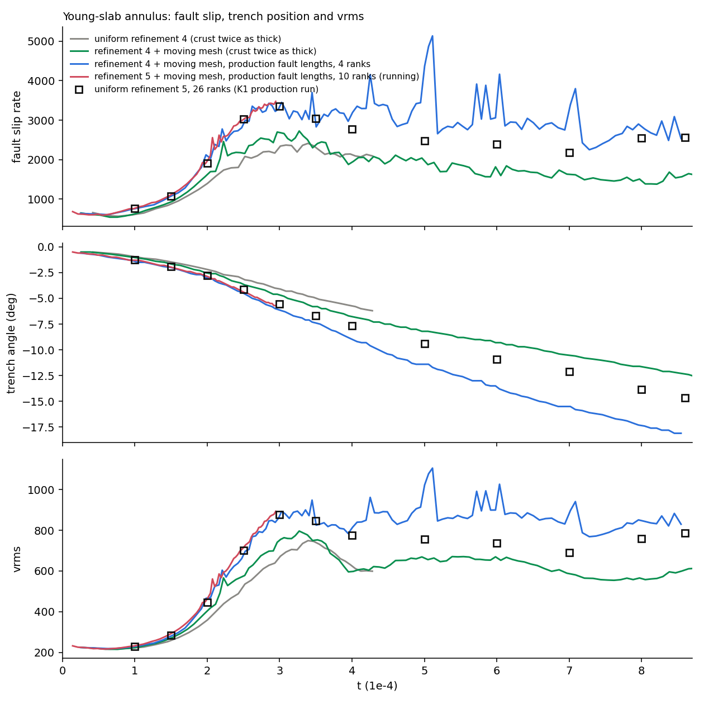
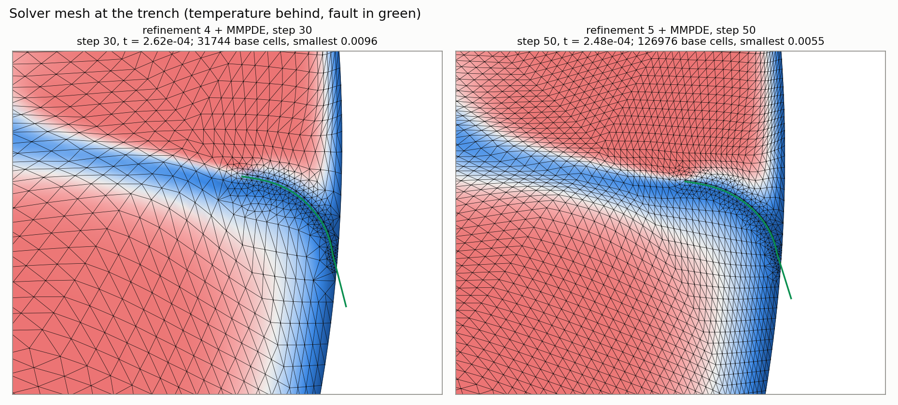

# Sample runs: a moving mesh with an embedded fault (young-slab annulus)

Status at 2026-11-13 04:00 UTC. Written for the write-up of the moving-mesh (MMPDE) plus fault work.

## What the runs are

- **Model.** The young-slab subduction annulus of the zg95 lid-regime campaign: outer radius 2.222, inner 1.222 (unit = 2900 km), one slab with a weak crust, and one fault at the plate boundary carried as a split in the mesh.
- **Each step.** The fault is cut into the base mesh as a "ladder" of quadrilateral-like rungs (spacing S, band width 2S), the Stokes problem is solved on that mesh with multigrid over the refinement levels, and temperature is advected on the base mesh.
- **What is new.** The base mesh moves: every 5 steps its nodes are redistributed to follow the temperature gradient (finest to coarsest cell-size ratio 8), with three moves on the initial temperature before the first fault is cut. The fault ladder is then cut into the moved mesh.
- **Reference.** A uniform-mesh production run of the same model at refinement 5 on 26 ranks (126,976 base cells), run on a Linux cluster by the session that owns the production models. It ran 800 steps to t = 4.1e-3, at a median 100 s/step.
- **Where they ran.** A 96-thread Linux workstation (single system image; Intel Xeon Gold 6240R; MPICH), shared with other jobs, so wall times are indicative only.
- **Code.** underworld3 development at 613ed1e0 (includes the parallel placement fix, #1094). The driver is `annulus_faults.py` with three added options: `uw_mmpde_init`, `uw_mmpde_every`, `uw_mmpde_spacing`.

## The runs

| Run tag | Base cells | Ranks | Fault lengths | Mesh | Steps | t_end | s/step | Wall |
|---|---|---|---|---|---|---|---|---|
| `baseline_ref4_x2_np4` | 31,744 | 4 | doubled | uniform | 40 | 4.3e-4 | 95 | 1.0 h |
| `mmpde5_ref4_np4_dev` | 31,744 | 4 | doubled | moving | 120 | 9.9e-4 | 134 | 4.6 h |
| `mmpde5_ref4_np4_dev_sfollow` | 31,744 | 4 | doubled, rungs sized to the moved mesh | moving | 120 | 1.03e-3 | 153 | 5.1 h |
| `mmpde5_ref4_prod_np4` | 31,744 | 4 | production | moving | 120 | 8.6e-4 | 202 | 6.7 h |
| `mmpde5_ref5_prod_np10` | 126,976 | 10 | production | moving | running (64 at 03:00 UTC) | 2.8e-4 so far | 362 | stops at 07:33 UTC |
| `mmpde5_ref4_np1_s80` | 31,744 | 1 | doubled | moving | 80 | 6.2e-4 | 348 | 8.0 h |

- "Production" fault lengths: rung spacing 0.0078125, crust thickness 0.00390625, crust depth 0.006. "Doubled" is twice each (the low-resolution recipe).
- Refinement 4 is 31,744 base cells; refinement 5 is 126,976.
- All steps converged in every run listed. No solver divergence.

## Main result

With the moving mesh, refinement 4 reproduces the uniform refinement-5 production run through the slip peak (to t ≈ 3.5e-4), on a quarter of the cells. After the peak it does not: slip stays 30% to 50% too high and the trench retreats too fast.

Entries are fault slip rate / trench angle / vrms.

| t | Uniform ref 4 (doubled lengths) | Ref 4 + moving mesh (production lengths) | Ref 5 + moving mesh (production lengths) | Uniform ref 5 production run |
|---|---|---|---|---|
| 1.0e-4 | 610 / −0.96° / 222 | 756 / −1.41° / 229 | 766 / −1.30° / 232 | 767 / −1.25° / 230 |
| 1.5e-4 | 874 / −1.46° / 259 | 1075 / −2.00° / 280 | 1110 / −1.97° / 292 | 1079 / −1.90° / 284 |
| 2.0e-4 | 1392 / −2.19° / 358 | 2096 / −3.00° / 467 | 1964 / −2.87° / 463 | 1904 / −2.76° / 445 |
| 2.5e-4 | 2018 / −3.13° / 525 | 2899 / −4.50° / 678 | 3018 / −4.39° / 715 | 3024 / −4.15° / 701 |
| 3.0e-4 | 2318 / −4.09° / 668 | 3341 / −6.14° / 871 | 3419 / −5.53° / 875 (at 2.9e-4; running) | 3361 / −5.57° / 877 |
| 3.5e-4 | 2307 / −4.98° / 740 | 2907 / −7.39° / 836 | | 3037 / −6.70° / 847 |
| 4.0e-4 | 2125 / −5.73° / 624 | 3167 / −8.97° / 811 | | 2777 / −7.68° / 775 |
| 5.0e-4 | | 4319 / −11.40° / 1017 (a one-step spike) | | 2470 / −9.42° / 755 |
| 6.0e-4 | | 3412 / −13.60° / 940 | | 2390 / −10.90° / 737 |
| 7.0e-4 | | 3257 / −15.50° / 883 | | 2186 / −12.09° / 691 |
| 8.0e-4 | | 2839 / −17.35° / 847 | | 2553 / −13.82° / 758 |

- Up to t = 3.5e-4 the refinement-4 moving-mesh run is within about 5% of the production run in slip and vrms, except slip at 2.0e-4, which is 10% high. Its trench runs ahead by 0.1° to 0.7°.
- The refinement-5 moving-mesh run sits on the production run's points to within 4% as far as it has gone (t = 2.95e-4), and its trench angle is closer to the production run's than the refinement-4 run's is. So the refinement-4 trench running ahead looks like a resolution effect.
- The uniform refinement-4 run is not like for like (its crust and rungs are twice as thick), but it shows the size of the gap: slip peak 2400 against 3361.

## The meshes

At t ≈ 2.5e-4 the base cell at the fault is 0.020 (refinement 4) and 0.010 (refinement 5). The ladder brings both to 0.0078 on the fault.

Other figures in this branch:

- `fault_mesh_parallel_demo_step100.png`, `fault_compare_parallel_demo.png`: the doubled-length runs, serial against 4 ranks.
- `fault_mesh_ladder_sized_step10.png`, `fault_compare_ladder_sized.png`: rungs sized to the moved mesh against the fixed recipe size.

## Parallel against serial

At refinement 4 with doubled lengths, the 4-rank and serial moving-mesh runs agree to within 2% in the vrms peak and 0.2° in trench angle. Slip differs by up to 14% at single times during the jump near t = 2e-4. The two were on different builds, so this is an upper bound on the rank-count effect, not a measurement of it.

## Caveats to state in the write-up

- **Late time does not agree.** After t = 3.5e-4 the refinement-4 production-length run departs from the production run. From 5e-4 to 8e-4 its slip is 2800 to 3400 against 2200 to 2600, its vrms 850 to 940 against 690 to 760, and its trench 2° to 3.5° further on (−17.4° against −13.8° at 8.0e-4). Whether the refinement-5 moving-mesh run does better after the peak is not known yet: it will be stopped near t = 3.8e-4.
- **Slip spikes.** That run has one-step slip spikes after the peak (up to 5100 at t ≈ 5.1e-4, against a level near 3000). Cause not investigated.
- **One placement refusal.** At step 84 of that run the fault could not be cut ("the fault touches the domain boundary"); the previous step's fault was kept for one step. This is a known limit for a fault that ends within a few fine cells of a wall (#1090).
- **Cost.** To t = 4.0e-4 the refinement-4 moving-mesh run took 57 steps and 3.2 h on 4 ranks (13 core-hours). The production run took 84 steps at about 113 s/step on 26 ranks (about 69 core-hours, estimated from its median step time). That is roughly a fifth of the core-hours at a similar wall time, but on different machines, and ours was shared, so quote it as indicative. At equal resolution the moving mesh costs more, not less: 363 s/step on 10 ranks at refinement 5 against 100 s/step on 26 ranks.
- **Rank count.** The mover's result depends weakly on the rank count through evaluation at partition seams (#1093, #1107). Compare runs at a fixed rank count.
- **Not for use.** A serial run with an extra plate-boundary term in the metric and rungs sized to the moved mesh fell well behind the others (slip peak 2011) and is treated as suspect.
- **Rung size.** The rung spacing is set once at the start and never changed during a run. Sizing it from the moved mesh (0.0088 against the recipe's 0.0156 at doubled lengths) changes the peak by a few percent; the exact ratio is secondary.
